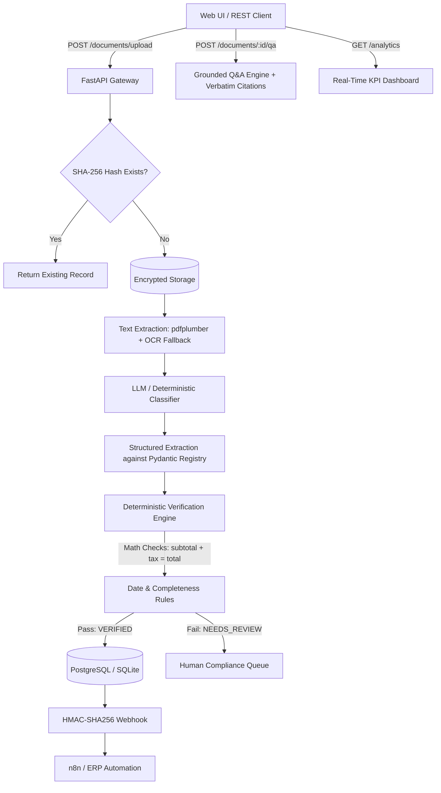

# DocSmart AI — Enterprise Document Intelligence & Workflow Automation

[](https://vercel.com/new/clone?repository-url=https%3A%2F%2Fgithub.com%2Fbaluroxta%2Fdocsmart-ai)


> **"Turn documents into decisions."**

DocSmart AI is an enterprise-grade document intelligence platform designed to eliminate manual data entry, audit extraction accuracy, enforce deterministic business rules, and automate downstream enterprise workflows.

Developed by **Kandala Guru Balaji** as an independent enterprise AI portfolio project demonstrating production-grade document intelligence, deterministic verification, and workflow automation.

---

## Table of Contents
- [Executive Overview](#executive-overview)
- [The Business Problem](#the-business-problem)
- [System Architecture](#system-architecture)
- [Core Capabilities](#core-capabilities)
  - [1. Intelligent Multi-Format Ingestion](#1-intelligent-multi-format-ingestion)
  - [2. Schema-Grounded LLM Extraction](#2-schema-grounded-llm-extraction)
  - [3. Deterministic Verification & Exception Engine](#3-deterministic-verification--exception-engine)
  - [4. Grounded AI Question-Answering with Citations](#4-grounded-ai-question-answering-with-citations)
  - [5. Downstream Workflow Automation (n8n Webhook)](#5-downstream-workflow-automation-n8n-webhook)
  - [6. Real-Time Analytics Dashboard & CSV Export](#6-real-time-analytics-dashboard--csv-export)
- [Tech Stack](#tech-stack)
- [Project Structure](#project-structure)
- [Quickstart & Installation](#quickstart--installation)
  - [Prerequisites](#prerequisites)
  - [Local Development (Zero-Config SQLite)](#local-development-zero-config-sqlite)
  - [Docker Production Setup](#docker-production-setup)
- [API Reference](#api-reference)
- [Deterministic Verification Rules](#deterministic-verification-rules)
- [Security & Compliance](#security--compliance)
- [Testing](#testing)
- [Portfolio & Interview Showcase](#portfolio--interview-showcase)
- [Attribution & License](#attribution--license)

---

## Executive Overview

Enterprises process thousands of invoices, contracts, statements of work, and candidate profiles monthly. Standard OCR solutions often extract raw text without structure, while naive LLM chat wrappers hallucinate missing facts, miss mathematical inconsistencies, and lack audit trails.

**DocSmart AI** introduces an industrial pipeline:
1. **Idempotent Ingestion**: SHA-256 deduplication and MIME validation.
2. **Hybrid OCR/Text Extraction**: High-speed native digital extraction with graceful fallback.
3. **Type-Specific Pydantic Schemas**: Bounded classification into Invoices, Contracts, Resumes, and Forms.
4. **Deterministic Math & Logic Engine**: Code-level verification of `Subtotal + Tax == Total Amount` and chronological date validation.
5. **Grounded Q&A**: Strict citation attribution quoting exact verbatim document excerpts.
6. **HMAC Signed Automation**: Downstream triggering of n8n, ERPs, and accounting hubs.

---

## The Business Problem

| Operational Pain Point | Enterprise Impact | DocSmart AI Solution |
| :--- | :--- | :--- |
| **Manual PDF Re-Keying** | High operational spend; staff manually transcribing numbers from invoices into ERPs. | Automated schema extraction with instant CSV/ERP export. |
| **Silent Arithmetic Inconsistencies** | Invoices with miscalculated line items or tax discrepancies go unnoticed until payment audits. | Deterministic verification engine flags `ARITHMETIC_INCONSISTENCY` before persistence. |
| **Hallucinated Citations** | Standard AI chatbots invent page numbers or terms when queried. | Verbatim quote attribution with exact section line references; honest "Not Found" state. |
| **No Operational Audit Trail** | Teams cannot verify extraction timestamps, latency, or model confidence. | Append-only `processing_logs` table tracking latency and status per stage. |

---

## System Architecture



---

## Core Capabilities

### 1. Intelligent Multi-Format Ingestion
- Ingests digitally-created PDFs, scanned documents, and image formats (`.pdf`, `.png`, `.jpg`).
- SHA-256 content hashing guarantees idempotency (re-uploading returns the existing record instantly).
- File size caps (15MB) and MIME validation prevent resource exhaustion.

### 2. Schema-Grounded LLM Extraction
- Automatically classifies documents into:
  - `invoice`: Vendor, customer, invoice number, issue/due dates, subtotal, tax, total, and itemized line items.
  - `contract`: Parties A & B, effective date, expiration date, annual contract value, key clauses, and governing law.
  - `resume`: Candidate name, contact details, years of experience, technical skills catalog, and education.
  - `form`: Dynamic label-value form fields.
- Multi-provider support: **Anthropic Claude**, **OpenAI GPT-4o-mini**, or the **DocSmart Offline Deterministic Engine** for zero-dependency local testing.

### 3. Deterministic Verification & Exception Engine
Rather than relying on LLMs to self-grade, DocSmart AI uses code-level deterministic business logic:
- **Arithmetic Check**: Evaluates $|(\text{Subtotal} + \text{Tax}) - \text{Total Amount}| \le 0.05$.
- **Line Items Summation**: Confirms $\sum \text{Line Items} == \text{Subtotal}$.
- **Date Chronology**: Verifies `issue_date <= due_date` and `effective_date <= expiration_date`.
- **Identity Conflict Detection**: Flags agreements where Party A and Party B are identical entities.
- Transparent statuses: `VERIFIED`, `NEEDS_REVIEW`, and `DISCREPANCY_DETECTED`.

### 4. Grounded AI Question-Answering with Citations
- Natural language queries: *"What is the total amount?"*, *"Who are the contracting parties?"*, *"What is the payment deadline?"*.
- Strict grounding in document text with exact verbatim source quotes and line numbers.
- Zero-hallucination guarantee: gracefully reports when information is absent.

### 5. Downstream Workflow Automation (n8n Webhook)
- Verified documents trigger an outbound webhook to n8n workflows.
- Payloads are signed with an HMAC-SHA256 signature (`X-Signature`) using `WEBHOOK_SIGNING_SECRET` to prevent tampering.

### 6. Real-Time Analytics Dashboard & CSV Export
- Live KPI cards: Total Ingested, Completed Pipeline, Verification Pass Rate, and Stage Latency.
- Document type distribution breakdown and live audit log stream.
- One-click CSV export with RFC-compliant quote and comma escaping.

---

## Tech Stack

| Domain | Technologies |
| :--- | :--- |
| **Frontend** | React 18, TypeScript, Vite, Vanilla CSS Design System, Lucide Icons |
| **Backend** | Python 3.11, FastAPI, Pydantic v2, Pydantic-Settings |
| **Database** | SQLAlchemy 2.0 (Dual-mode: SQLite for zero-config dev, PostgreSQL for production) |
| **Text Extraction** | pdfplumber (pure native PDF parsing), PyTesseract (OCR fallback), pdf2image |
| **AI Integration** | Anthropic Claude, OpenAI, and DocSmart Deterministic Offline Fallback Engine |
| **Automation** | n8n Webhook with HMAC-SHA256 signature verification |
| **DevOps** | Docker, docker-compose, pytest, pytest-asyncio |

---

## Project Structure

```text
Docsmart/
├── frontend/                     # React + TypeScript Web Application
│   ├── src/
│   │   ├── components/
│   │   │   ├── Navbar.tsx        # Navigation with demo triggers
│   │   │   ├── LandingPage.tsx   # SaaS Overview & Architecture Visualizer
│   │   │   ├── Workspace.tsx     # Queue, Split-Pane Inspector, Q&A, and Audit
│   │   │   ├── AnalyticsView.tsx # Live Metrics & KPI Feed
│   │   │   └── Footer.tsx        # Enterprise footer & attribution
│   │   ├── api.ts                # Frontend API client
│   │   ├── App.tsx               # Root view router
│   │   ├── main.tsx              # React DOM entrypoint
│   │   └── index.css             # Enterprise Slate design tokens
│   ├── vite.config.ts            # Vite proxy & build config
│   └── package.json
├── src/                          # FastAPI Backend Engine
│   ├── main.py                   # App entrypoint, CORS & static SPA mount
│   ├── config.py                 # Pydantic environment settings
│   ├── database.py               # Dual SQLite / PostgreSQL engine
│   ├── models.py                 # ORM Models (Document, ExtractionResult, ProcessingLog)
│   ├── schemas.py                # Pydantic Request, Response & Extraction Schemas
│   ├── security.py               # API key auth & HMAC webhook signing
│   ├── ai/
│   │   ├── client.py             # Multi-provider LLM client with fallback
│   │   ├── classifier.py         # Document type classifier
│   │   ├── extractor.py          # Type-specific schema extractor
│   │   └── intelligent_demo.py   # Deterministic offline extraction engine
│   ├── ocr/
│   │   └── extractor.py          # pdfplumber native text & OCR fallback
│   ├── services/
│   │   ├── document_service.py   # State machine pipeline orchestrator
│   │   ├── validation_service.py # Completeness scoring
│   │   ├── verification_service.py # Deterministic math & date rules
│   │   └── qa_service.py         # Grounded Q&A with verbatim citations
│   └── api/
│       └── routes.py             # REST API endpoints
├── samples/                      # Realistic Enterprise Sample Business PDFs
│   ├── sample_acme_invoice.pdf
│   ├── sample_saas_contract.pdf
│   └── sample_ai_engineer_resume.pdf
├── tests/
│   ├── unit/                     # Schema, verification, QA, and security unit tests
│   └── integration/              # Health and upload integration tests
├── scripts/
│   ├── init_db.py                # Table initialization
│   └── generate_samples.py       # ReportLab PDF generator
├── docker/                       # Dockerfile & docker-compose.yml
├── .env.example                  # Environment configuration template
└── requirements.txt              # Python dependencies
```

---

## Quickstart & Installation

### Prerequisites
- Python 3.11+
- Node.js 18+ and npm
- (Optional) Docker & docker-compose

### Local Development (Zero-Config SQLite)

1. **Clone the repository:**
   ```bash
   git clone https://github.com/kandalabalaji/DocSmart-AI.git
   cd DocSmart-AI
   ```

2. **Set up Python backend:**
   ```bash
   pip install -r requirements.txt
   cp .env.example .env
   python scripts/init_db.py
   python scripts/generate_samples.py
   ```

3. **Start the backend server:**
   ```bash
   python -m uvicorn src.main:app --host 127.0.0.1 --port 8000 --reload
   ```

4. **Set up and start the frontend:**
   ```bash
   cd frontend
   npm install
   npm run dev
   ```
   Open `http://localhost:5173` (or `http://localhost:8000` for the production bundle).

### Docker Production Setup

```bash
cp .env.example .env
docker compose -f docker/docker-compose.yml up --build
```
Interactive Swagger UI will be available at `http://localhost:8000/docs`.

---

## API Reference

| Method | Endpoint | Description | Auth Required |
| :--- | :--- | :--- | :--- |
| `GET` | `/health` | System health check | No |
| `GET` | `/documents` | List documents with status and extraction preview | No |
| `POST` | `/documents/upload` | Ingest and process a business document (PDF/Image) | Yes (`X-API-Key`) |
| `GET` | `/documents/{id}/detail` | Full document record with extracted data, verification checks, and audit logs | No |
| `GET` | `/documents/{id}/text` | Raw extracted document text | No |
| `POST` | `/documents/{id}/qa` | Grounded Q&A with verbatim excerpt citations | No |
| `GET` | `/documents/{id}/verification` | Deterministic verification status and exceptions | No |
| `GET` | `/documents/{id}/export/csv` | Download RFC-compliant CSV of extracted data | No |
| `GET` | `/analytics` | Aggregated metrics, type breakdown, and live audit logs | No |
| `POST` | `/documents/seed-samples` | Seeds and processes the 3 demo enterprise PDFs | No |
| `POST` | `/documents/{id}/reprocess` | Re-runs the full pipeline on an existing document | Yes (`X-API-Key`) |

---

## Testing

DocSmart AI maintains a comprehensive suite of unit and integration tests:

```bash
pytest tests/ -v
```

**Results:**
```text
tests/integration/test_api_health.py::test_health_check PASSED           [  4%]
tests/integration/test_upload_auth.py::test_upload_without_api_key_rejected PASSED [  9%]
tests/integration/test_upload_auth.py::test_get_document_without_api_key_rejected PASSED [ 14%]
tests/unit/test_docsmart_qa.py::test_qa_grounded_answer PASSED           [ 19%]
tests/unit/test_docsmart_verification.py::test_verify_invoice_arithmetic_valid PASSED [ 23%]
tests/unit/test_docsmart_verification.py::test_verify_invoice_arithmetic_discrepancy PASSED [ 28%]
tests/unit/test_docsmart_verification.py::test_verify_invoice_date_inversion PASSED [ 33%]
tests/unit/test_docsmart_verification.py::test_verify_contract_valid PASSED [ 38%]
tests/unit/test_docsmart_verification.py::test_verify_contract_identical_parties PASSED [ 42%]
tests/unit/test_docsmart_verification.py::test_verify_resume_valid PASSED [ 47%]
tests/unit/test_schemas.py::test_classification_result_valid_type PASSED [ 52%]
tests/unit/test_schemas.py::test_classification_result_invalid_type_coerced_to_unknown PASSED [ 57%]
tests/unit/test_schemas.py::test_classification_confidence_out_of_range_rejected PASSED [ 61%]
tests/unit/test_schemas.py::test_extraction_schema_registry_has_all_supported_types PASSED [ 66%]
tests/unit/test_schemas.py::test_invoice_data_accepts_partial_data PASSED [ 71%]
tests/unit/test_security.py::test_signature_roundtrip PASSED             [ 76%]
tests/unit/test_security.py::test_signature_detects_tampering PASSED     [ 80%]
tests/unit/test_validation_service.py::test_score_extraction_all_fields_filled_scores_high PASSED [ 85%]
tests/unit/test_validation_service.py::test_score_extraction_mostly_empty_scores_low PASSED [ 90%]
tests/unit/test_validation_service.py::test_is_valid_respects_threshold PASSED [ 95%]
tests/unit/test_validation_service.py::test_is_valid_fails_closed_on_boundary PASSED [100%]

============================= 21 passed in 2.92s ==============================
```

---

## Security & Compliance

1. **Prompt Injection Guardrails**: LLM system prompts explicitly treat document text as untrusted data. The model can only emit schema-constrained JSON without tool-calling privileges.
2. **Fail-Closed Validation**: If confidence is below threshold or arithmetic mismatches occur, the document is flagged `NEEDS_REVIEW` and never silently marked complete.
3. **Webhook Security**: Outbound n8n payloads are signed with HMAC-SHA256 (`X-Signature`), allowing recipient systems to verify authenticity and tamper resistance.
4. **Zero Exposed Secrets**: Secrets are loaded strictly via environment variables; `.env` is safely gitignored.

---

## Authorship & License

- **Developer:** Developed by **Kandala Guru Balaji**.
- **License:** Licensed under the **MIT License** — see [LICENSE](LICENSE).

---

<div align="center">
  <b>DocSmart AI © 2026 | Developed by Kandala Guru Balaji</b><br>
  <i>Turn documents into decisions.</i>
</div>
